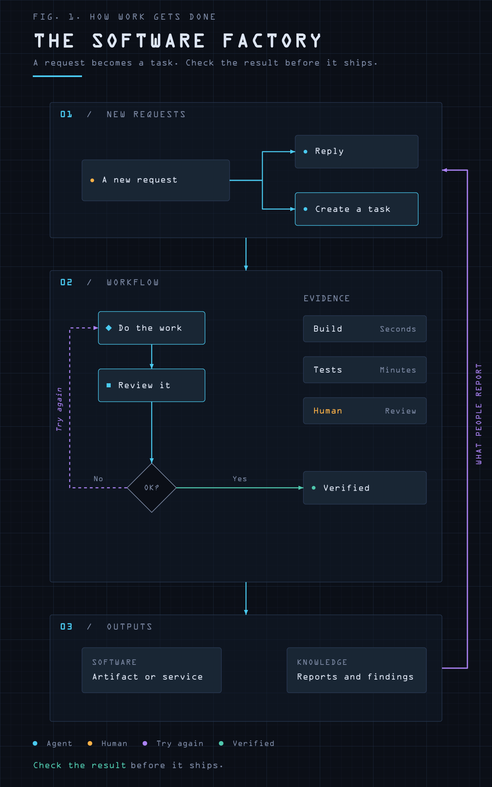
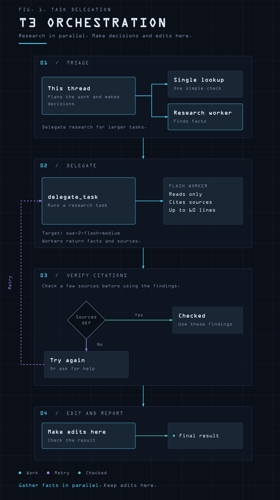
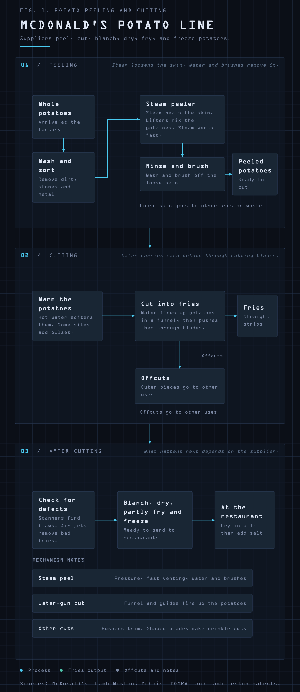

# blueprint-diagram

An agent skill that generates dark technical "blueprint" SVG figures — near-black
grid paper, monospace type, numbered section frames, cyan flow lines, purple
feedback rails, amber human-in-the-loop nodes, green shipped outputs.

The style is encoded in `blueprint.py` + `layout.py`; the agent supplies only
content and layout intent. `SKILL.md` tells the agent when and how to use it.

## Install

Clone into your agent's skills directory:

```bash
git clone https://github.com/joaomcarlos/blueprint-diagram ~/.config/devin/skills/blueprint-diagram
```

Works with any runtime that reads `SKILL.md` skills (`~/.config/devin/skills/`,
`~/.claude/skills/`, `~/.agents/skills/`).

## Examples

### The Software Factory — `example.py` → `factory.svg`



The reference figure, reproduced from a screenshot of [this post](https://x.com/pauldix/status/2118076194163687474)
by Paul Dix. The skill itself was born from the request:

> "/loop encode this design of this graph in a skill. The idea is that if I ask
> the agent to explain something with a graph it uses this skill to get me a SVG
> picture that looks like the one in the picture. Encode the skill, then
> recursively test it using a sub-agent until the output of what you get looks
> like the source image."

### T3 Orchestration — `t3-orchestration.py` → `t3-orchestration.svg`



First real-world use — the same agent was asked to explain the orchestration
delegation policy from its own system instructions:

> "do you see a T3 orchestration delegation policy in your instructions?
> explain it using the blueprint skill"

### Potato Fries — `potato_diagram.py` → `potato-fries.svg`



Generalization test on unrelated content, delegated to a sub-agent:

> "lets do a test, in a sub-agent ask it to use the skill to explain the
> mechanics of the mcdonalds potatoe peeling and chopping process"

`*-reading.png` files are 720px-wide previews rendered alongside each native-size PNG.

## Files

- `SKILL.md` — trigger conditions, design language, workflow (render-and-look required)
- `blueprint.py` — drawing primitives (panels, nodes, cards, ladders, edges, fans, rails)
- `layout.py` — measured layout and geometry validation (export gate)
- `render.py` — SVG → PNG previews via `rsvg-convert`
- `test_blueprint.py` — 21 regression cases
- `example.py`, `t3-orchestration.py`, `potato_diagram.py` — the scripts behind the figures above
- `REVIEW.md` — notes from the skill's own repair review
